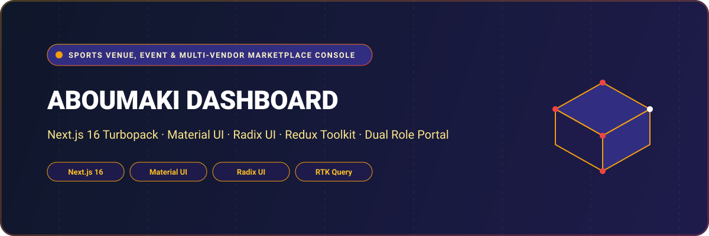

<div align="center">



# Aboumaki Dashboard — Sports Venue, Event & Multi-Vendor Marketplace Console

A comprehensive, role-separated management platform supporting sports facility operations, playground/court reservations, sporting event ticketing, and sports gear e-commerce. Built with **Next.js 16 (App Router with Turbopack)**, **Material UI 7**, **Radix UI**, **Redux Toolkit**, and **Tailwind CSS**.

[](https://nextjs.org/)
[](https://mui.com/)
[](https://www.radix-ui.com/)
[](https://redux-toolkit.js.org/)
[](https://www.typescriptlang.org/)
[](LICENSE)

</div>

---

## 🌟 Overview

**Aboumaki Dashboard** provides a robust, dual-role management console designed specifically for sports venues, court operators, tournament organizers, and sports merchants. It features dedicated viewports for **SuperAdmin Platform Operators** and **Sporting Facility Vendors**:

- **Admin Viewport**: Platform-wide transaction ledger, vendor onboarding & verification, sports category taxonomy, order fulfillment, and customer database.
- **Vendor Viewport**: Turf/playground hourly booking calendars, tournament/event registration ticketing, product inventory catalog, order processing, and banking settlement.

---

## 🚀 Key Features & Capabilities

- 🏟️ **Playground & Turf Scheduling**: Slot configuration, hourly rate management, conflict detection, and live court occupancy tracking.
- 🎟️ **Sporting Events & Tournament Ticketing**: Ticket tiering, capacity management, participant rosters, and tournament scheduling.
- 🛍️ **Multi-Vendor E-Commerce Store**: Vendor product catalog, inventory variations, order fulfillment workflows, and shipment updates.
- 💳 **Financial Clearing & Bank Settlements**: Vendor payout requests, transaction history, platform fee calculation, and automated invoicing.
- 👥 **Dual Role-Based Access Control**: Distinct route middleware separating administrative oversight from autonomous vendor portals.
- ⚡ **Turbopack & Modern Component Architecture**: Instant route transitions and high-performance forms powered by Material UI and React Hook Form.

---

## 🏛️ System Architecture

```
[ Platform Administrators ]                 [ Facility Vendors & Merchants ]
            │                                             │
            ▼                                             ▼
   [ Next.js 16 Turbopack Portal (App Router Middleware RBAC) ]
   ├── Admin Console                             ├── Vendor Console
   │   ├── Vendor Onboarding & Vetting           │   ├── Playground & Turf Booking Grid
   │   ├── Global Transaction Audits             │   ├── Event & Tournament Ticketing
   │   ├── Sports Category Hierarchy             │   ├── E-Commerce Product Catalog
   │   └── Customer Support CRM                  │   └── Banking & Payout Ledger
            │                                             │
            └──────────────────────┬──────────────────────┘
                                   │
                                   ▼ (RTK Query / REST API)
                        [ Aboumaki Backend Services ]
```

---

## 📁 Repository Structure

```
aboumaki_dashboard/
├── assets/
│   └── banner.svg                  # Architectural SVG project banner
├── public/                         # Logos, icons, and static images
├── src/
│   ├── app/
│   │   ├── (auth)/                 # Login, password reset, account onboarding
│   │   ├── (dashboard)/            # Primary protected management views
│   │   │   ├── admin/              # SuperAdmin viewports
│   │   │   │   ├── manage-customers/   # Client accounts & reservations
│   │   │   │   ├── manage-order/       # Global orders and refunds
│   │   │   │   ├── manage-transactions/# Platform fee & financial logs
│   │   │   │   ├── manage-vendor/      # Vendor accreditation & status
│   │   │   │   └── sports-category/    # Sports taxonomy (Soccer, Padel, Tennis, etc.)
│   │   │   ├── vendor/             # Vendor viewports
│   │   │   │   ├── playground/         # Court/field calendar & reservation slots
│   │   │   │   ├── event/              # Tournaments, meets & match tickets
│   │   │   │   └── ecommerce/          # Equipment store & inventory
│   │   │   ├── bank-info/          # Payout accounts and IBAN records
│   │   │   └── settings/           # Profile preferences and notifications
│   │   ├── layout.tsx              # Root HTML wrapper with Redux & UI Providers
│   │   ├── globals.css             # Tailwind CSS tokens & styling
│   │   └── middleware.ts           # Route guard and authentication redirection
│   ├── components/                 # Modals, form fields, and navigation sidebars
│   ├── redux/                      # Redux Toolkit store and RTK Query services
│   └── lib/                        # Formatting utilities and token decoders
├── package.json                    # Next.js 16, Material UI 7, Radix UI dependencies
└── tsconfig.json                   # Strict TypeScript compiler options
```

---

## 💻 Tech Stack Specification

| Domain | Selected Technologies |
| :--- | :--- |
| **Framework** | Next.js 16 (App Router, Turbopack) |
| **Language** | TypeScript 5 (Strict Mode) |
| **Component Libraries** | Material UI (MUI) 7.2, Radix UI Primitives, Lucide Icons |
| **Styling** | Tailwind CSS 3.4, Emotion React & Styled |
| **State Management** | Redux Toolkit (RTK), RTK Query |
| **Forms & Validation** | React Hook Form, Zod Resolver |
| **Session & Auth** | JWT Decode, JS Cookie, Middleware Guards |

---

## 🛠️ Getting Started & Local Development

### Prerequisites

- **Node.js**: `v20.x` or higher
- **Package Manager**: `npm`, `yarn`, or `pnpm`

### 1. Clone the Repository

```bash
git clone https://github.com/shahjalal-labs/aboumaki_dashboard.git
cd aboumaki_dashboard
```

### 2. Install Dependencies

```bash
npm install
```

### 3. Configure Environment Variables

Create a `.env.local` file:

```env
NEXT_PUBLIC_BASE_URL_LOCAL=http://localhost:5000/api/v1
```

### 4. Run Development Server

```bash
npm run dev
```

Open [http://localhost:3000](http://localhost:3000) to view the application.

---

## 👨‍💻 Engineering & Authorship

Developed and engineered by **Md. Shahjalal**.

- **GitHub**: [@shahjalal-labs](https://github.com/shahjalal-labs)
- **Email**: [muhommodshahjalal@gmail.com](mailto:muhommodshahjalal@gmail.com)

---

## 📄 License

This project is open-source and available under the [ISC License](LICENSE).
